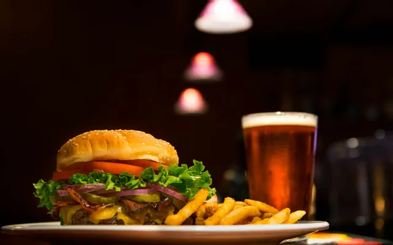
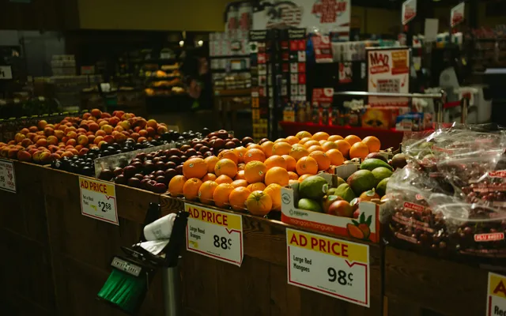
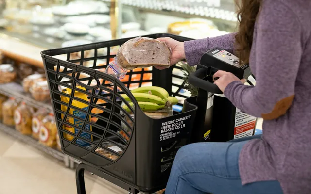

# Jiwoon Oh — Data Analyst

Data analyst. I work with promotion comparison, observational, and customer transaction data, using statistical analysis and machine learning to evaluate patterns and support business decisions.

**Site:** https://jiwoon-oh.github.io/portfolio/ · **Email:** [jiwoonds@gmail.com](mailto:jiwoonds@gmail.com)

## Projects

Each case study reports its estimates together with their limitations.

> Three promotions ran side by side. Can the data name a winner, or only a loser?

**Fast-Food Promotion Comparison** · *Group comparison* — ANOVA, Tukey HSD, Levene/Shapiro, Effect Size  
[Case study](https://jiwoon-oh.github.io/portfolio/projects/ab-test-fastfood/) · [Code](https://github.com/jiwoon-oh/fastfood-promotion-ab-test)

> If support follows a net-decline ranking, does it rank risk, or size?

**Seoul Closure Risk** · *Observational · Matching* — Propensity Score Matching, Stratified ATT, Cluster Bootstrap, Gradient Boosting  
[Case study](https://jiwoon-oh.github.io/portfolio/projects/seoul-closure-risk/) · [Code](https://github.com/jiwoon-oh/seoul-closure-risk)

> Is revenue growth coming from the heavy spenders everyone watches?

**Revenue Concentration** · *Descriptive · Predictive* — Lorenz/Gini, Wilcoxon/Mann-Whitney, Bootstrap CI, Logistic vs RF/SHAP  
[Case study](https://jiwoon-oh.github.io/portfolio/projects/dunnhumby-customer/case1/) · [Code](https://github.com/jiwoon-oh/dunnhumby-revenue-concentration)

> Campaigns look far more effective on low spenders. Is that the campaign, or who receives it?

**Campaign Response Heterogeneity** · *Panel · Fixed effects* — Two-way Fixed Effects, Clustered SE, Lead-Effect Testing, BH-FDR  
[Case study](https://jiwoon-oh.github.io/portfolio/projects/dunnhumby-customer/case2/) · [Code](https://github.com/jiwoon-oh/dunnhumby-campaign-response)

## About this repository

The site is plain HTML and CSS (`index.html`, `projects/`, `assets/`).
