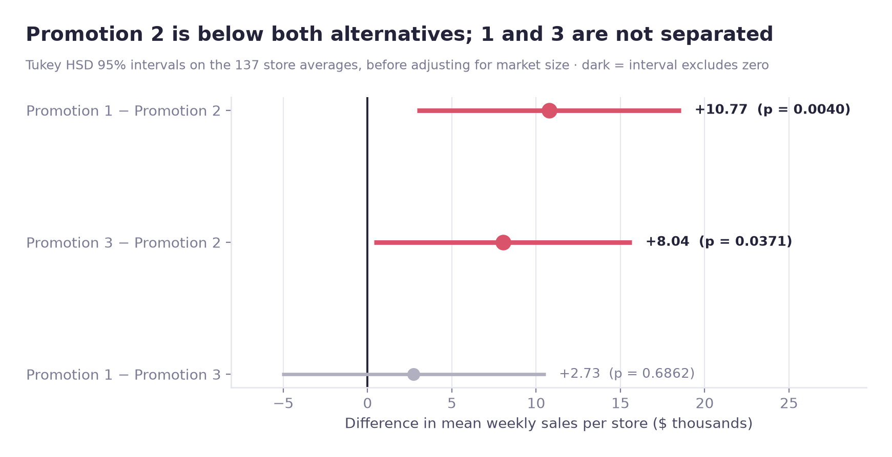
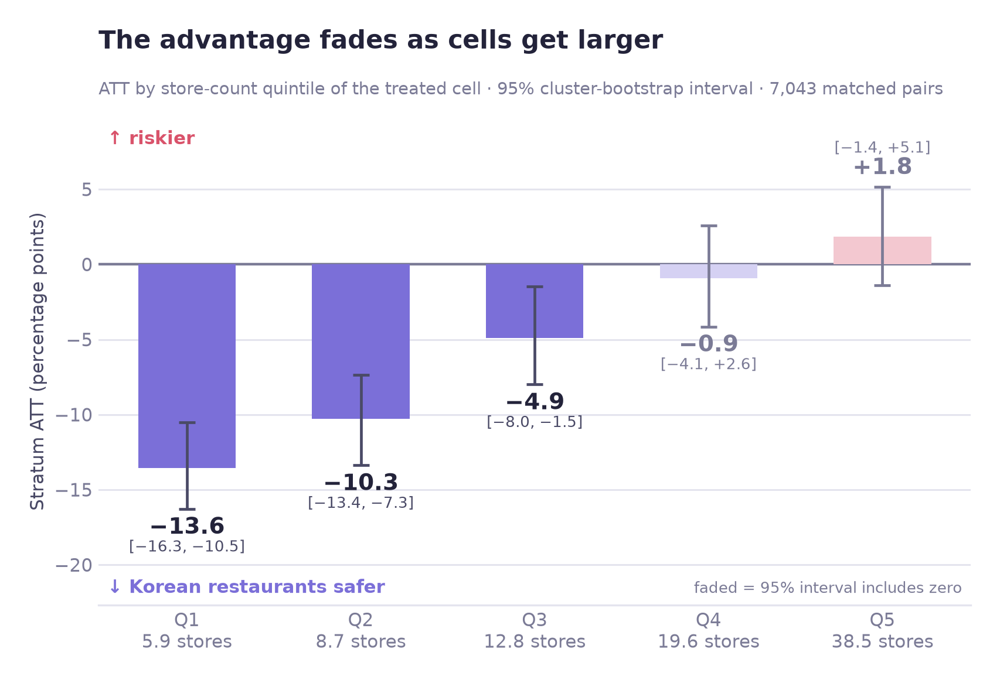
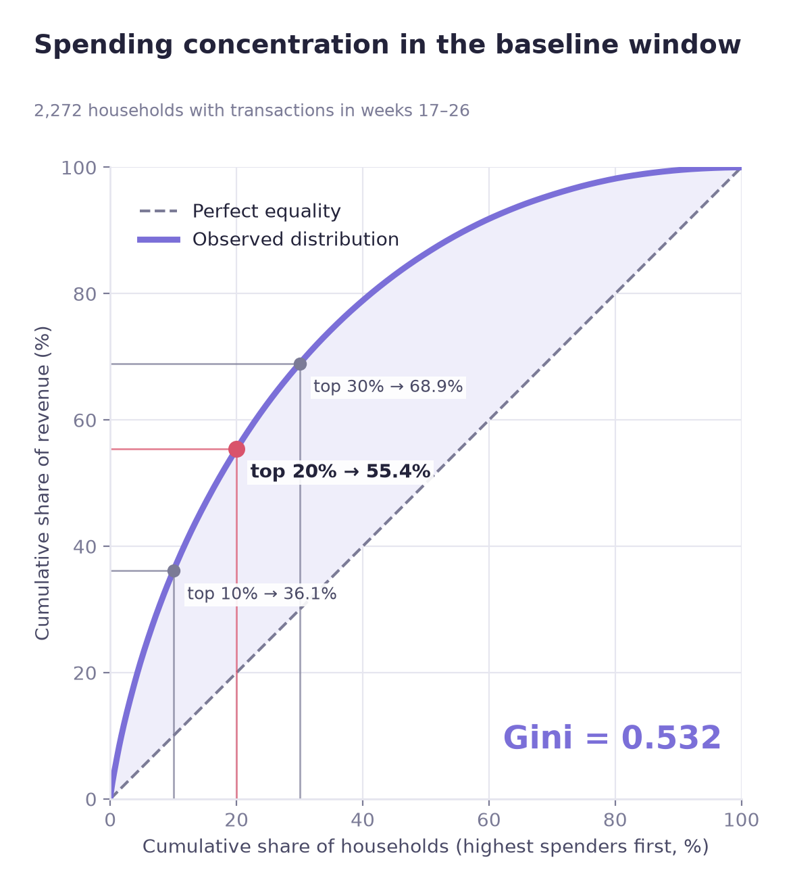
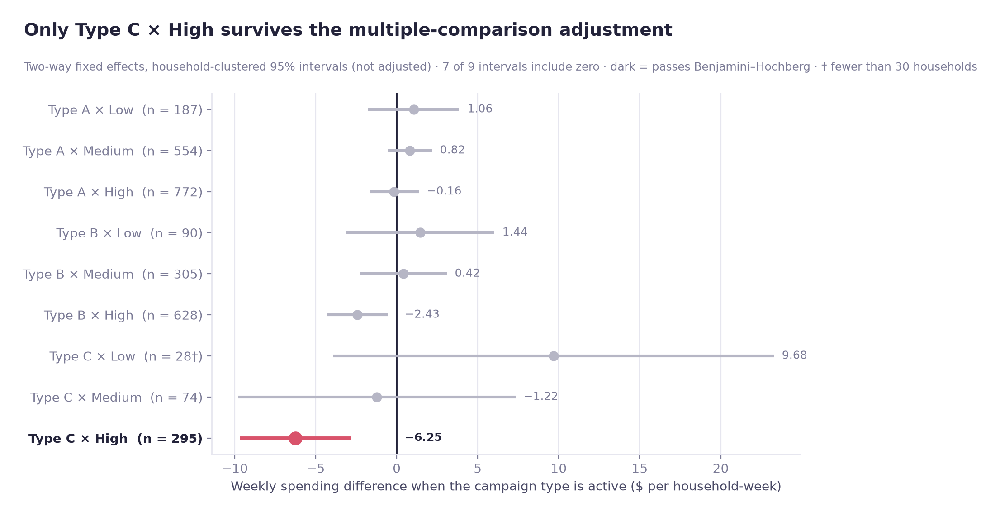

# Jiwoon Oh — Data Analyst

I check whether the effect is real. Data analyst working in causal inference, experimentation and machine learning.

**Site:** https://jiwoon-oh.github.io/portfolio/ · **GitHub:** [jiwoon-oh](https://github.com/jiwoon-oh) · **Email:** [qwer06187@gmail.com](mailto:qwer06187@gmail.com)

## Projects

Four case studies. Each one starts from a number someone already believed, then checks whether it survives.

### [Fast-Food Promotion A/B Test](https://github.com/jiwoon-oh/fastfood-promotion-ab-test)

Three promotions ran side by side. Which one actually lifted sales?

[Case study →](https://jiwoon-oh.github.io/portfolio/projects/ab-test-fastfood/)

### [Seoul Closure Risk](https://github.com/jiwoon-oh/seoul-closure-risk)

Seoul funds support by a net-decline metric. Does it rank risk, or size?

[Case study →](https://jiwoon-oh.github.io/portfolio/projects/seoul-closure-risk/)

### [Revenue Concentration](https://github.com/jiwoon-oh/dunnhumby-revenue-concentration)

Is revenue growth coming from the heavy spenders everyone watches?

[Case study →](https://jiwoon-oh.github.io/portfolio/projects/dunnhumby-customer/case1/)

### [Campaign Response Heterogeneity](https://github.com/jiwoon-oh/dunnhumby-campaign-response)

Campaigns look far more effective on low spenders. Is that the campaign, or who receives it?

[Case study →](https://jiwoon-oh.github.io/portfolio/projects/dunnhumby-customer/case2/)

## About this repository

The site is plain HTML and CSS (`index.html`, `projects/`, `assets/`).
